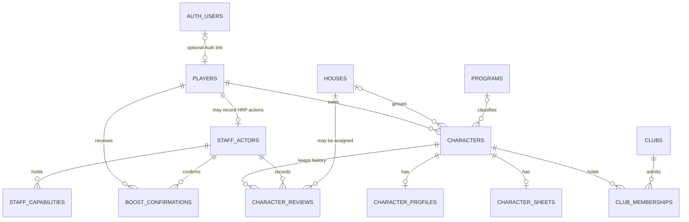

# Database schema

HU-004 uses PostgreSQL 17. `public` holds catalogs and basic RP profile fields that may be considered for future publication. `private` holds identities, detailed sheets, HRP actor records and operational data. All domain tables enable RLS. HU-005 adds the context-read RPC in `public`. HU-007A adds a write facade for Discord-linked account initialization with its privileged implementation in the unexposed `account_bootstrap` schema. HU-009B adds bounded staff-review and owner-history facades in `public` backed by the unexposed `character_review` schema. The Data API exposes only `public`. The generated TypeScript file also describes `private` for trusted code. See [Permissions](PERMISSIONS.md) for the client access boundary.

## Entity relationships

| Object                                             | Purpose and integrity                                                                                                                                                                                                   |
| -------------------------------------------------- | ----------------------------------------------------------------------------------------------------------------------------------------------------------------------------------------------------------------------- |
| `private.players`                                  | UUID identity, canonical unsigned 64-bit Discord snowflake stored as text, optional unique `auth.users` link. Removing the external Auth user clears the link.                                                          |
| `private.staff_actors`                             | Independently registered HRP actors. Playing a `staff_member` does not create an actor record. Functional capabilities are granted separately by a trusted operator.                                                    |
| `private.staff_capabilities`                       | Effective grants per actor, limited to known capability codes.                                                                                                                                                          |
| `public.bootstrap_discord_player()`                | Initializes the current player from an eligible Auth identity and returns the current authorization context.                                                                                                            |
| `public.current_player_context()`                  | Invoker-rights RPC returning only the linked caller’s player ID, capabilities, and owned character states.                                                                                                              |
| `private.boost_confirmations`                      | An absolute count, source, actor, reason and timestamp per confirmation. Trusted writers append a row for each change. The identity revision orders entries, including entries that share a timestamp.                  |
| `private.player_slot_capacity`                     | Invoker-rights view calculating five plus the latest confirmed count. It accesses no unaudited Discord data. HU-009A checks capacity before creating a player draft.                                                    |
| `private.characters`                               | Owner, kind, independent validation and use states, optional program and scholarship data, references to the current decision and House assignment, and an opaque write revision. An approved student requires a House. |
| `public.character_profiles`                        | One optional row per character for first name, last name and nickname. No rows are published in HU-004.                                                                                                                 |
| `private.character_sheets`                         | One optional row per character for sensitive identity and narrative fields, face claim, content warnings and RP links. Drafts may be partial.                                                                           |
| `private.character_reviews`                        | Staff reviews, outcomes, correction notes and optional House assignments. Composite foreign keys bind the decisions and assignments to the right character, and the reviewer cannot be its owner.                       |
| `public.houses`, `public.programs`, `public.clubs` | Catalogs with stable UUIDs, slugs and activation flags. The seeded BDE identity and slug are tied to a capacity of ten.                                                                                                 |
| `private.club_memberships`                         | One row per character and club, with join time, use state, optional responsibility and active seat reservations.                                                                                                        |

Keep reviews and boost confirmations as historical records. Clients have no direct write grant on history tables. The bounded staff review operation appends a decision and updates the character's current reference in one transaction. The current decision and current House can refer to different reviews. Approval and House assignment are validated by ordinary foreign keys and checks. Existing timestamp triggers maintain `updated_at`. HU-009A also rotates character revisions and locks capacity when a boost confirmation is appended. See the [character lifecycle](CHARACTERS.md#policy-and-concurrency) for the shared transaction lock and write contract.

## Club membership transactions

- To join or reactivate, write `active` and reserve character slot 1 or 2. Use the catalog's `capacity_key`, and reserve a seat from 1 through that capacity for a capped club. An uncapped club has key 0. Uncapped clubs may preassign positive, unique seats ahead of introducing a cap. Their active memberships may also have no club seat.
- To leave, set `inactive` and clear both reservations in the same statement. The character and club pair remains unique across states, so reactivation updates the existing row. A client's eligibility policy is separate from these limits.
- Unique indexes on `(character_id, character_slot)` and `(club_id, club_seat)` serialize conflicting claims. PostgreSQL waits for the conflicting transaction to finish. If it commits, the competing claim fails with SQLSTATE `23505`. A writer can retry with a different free slot or seat in a new transaction, and should report full capacity when none is available. The uniqueness of the pair also prevents simultaneous duplicate joins.
- A composite foreign key ties the copied capacity key to the current club row. PostgreSQL locks the referenced key against concurrent changes. Updating a capacity cascades the key to memberships and reapplies their seat checks. A change that would invalidate a reservation fails atomically. Preassign eligible seats or release affected memberships before reducing a cap. When writing several memberships in one transaction, use consistent character and club ordering and retry a transaction aborted for deadlock or serialization.
- `test:concurrency` runs separate PostgreSQL sessions and verifies that an uncommitted reservation blocks a competing write. It tests both the second character slot and the tenth BDE seat on a freshly reset local database.

## Hybrid sheets and archives

Characters hold sheet mode, validated external URL, lifetime refusal count and nullable archival time independently from validation and use status. Capacity counts nonarchived rows. Each new review records the examined revision and archive marker. External reviews additionally store the submitted URL and manual attestation.

`private.character_reopen_requests` binds each request to its character, owner and archive review. A partial unique index allows one pending request per archive cycle. Acceptance clears archive time and the current review pointer, rotates the sheet revision and preserves House, suspension and history. See the [migration guide](CHARACTER_POLICY_MIGRATION.md).

## Migrations

| File                                              | Contents                                                                                               |
| ------------------------------------------------- | ------------------------------------------------------------------------------------------------------ |
| `20261126231849_domain_identity_and_catalogs.sql` | Schemas, player identity, HRP actors, boost confirmations, capacity view and catalog tables.           |
| `20261126231850_characters_and_reviews.sql`       | Character records, profiles, sheets and review history.                                                |
| `20261126231852_club_memberships.sql`             | Membership state, reservations, duplicate prevention and capacity integrity.                           |
| `20261126231853_reference_catalogs.sql`           | The 12 Houses, 15 programs and 33 clubs and organizations from the server reference catalogs.          |
| `20261126235738_player_context_authorization.sql` | HRP capability grants, RLS policies and the bounded current-player RPC.                                |
| `20261127002939_bootstrap_discord_player.sql`     | Scoped Auth read policies, dedicated function owner and transactional Discord bootstrap.               |
| `20261127085714_restrict_discord_signups.sql`     | Private Discord signup allowlist and Before User Created hook.                                         |
| `20261127120000_character_lifecycle.sql`          | Character revisions, bounded player and catalog RPCs, RLS policies and the capacity lock.              |
| `20261127130000_character_review.sql`             | Bounded staff and owner review RPCs, a restricted reviewer role and indexes for the queue and history. |

Reference catalog data is versioned in migrations so it is available wherever the schema is built. Test fixtures are synthetic and live in rollback-only pgTAP transactions or in isolated concurrency probes that clean up their own data. See [business rules](BUSINESS_RULES.md) for unresolved policy decisions.

The two HU-009F-B migrations add the capability enum and then apply the character policy.
