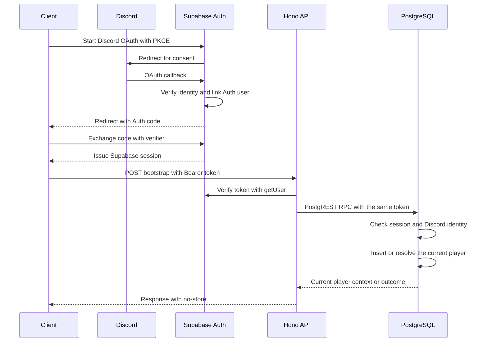

# Discord identity and player bootstrap

Supabase Auth handles Discord OAuth. The Worker verifies a Supabase user access token using the HU-005 middleware. The database reads one `auth.identities` row with `user_id = auth.uid()` and `provider = 'discord'`. Its textual `provider_id` is the Discord account ID. GoTrue v2.198.0 receives the ID from Discord's `/users/@me` and populates the provider subject used to create the identity. The application requires that `identity_data.sub` agree with that ID, and checks `identity_data.provider_id` when present. The internal `auth.identities.id` is a UUID. It is distinct from the provider ID.

The accepted snowflake is canonical decimal text in the unsigned 64-bit range, without leading zeros. The database rejects missing, multiple, malformed or internally inconsistent Discord identities. Metadata on `auth.users`, browser fields, email, display names and provider tokens are outside the authority chain.



The client sequence is the integration contract for HU-007B. HU-007A implements the API and database boundary.

## HTTP contract

Send `POST /api/v1/auth/bootstrap` with a Supabase access token in `Authorization: Bearer <token>`. Omit the request body and query string. For a new player, the `200` response contains `playerId`, empty `capabilities` and `characters` arrays and `canAccessCampus: false`. A matching existing player receives the exact `GET /api/v1/me` success shape, including their current capabilities and character states. The response is documented in OpenAPI and uses `Cache-Control: no-store`.

| HTTP status | Code                        | Outcome                                                              |
| ----------- | --------------------------- | -------------------------------------------------------------------- |
| 400         | `INVALID_BOOTSTRAP_REQUEST` | The caller supplied a body or query parameters.                      |
| 401         | `UNAUTHENTICATED`           | The access token or session is missing, invalid, expired or revoked. |
| 403         | `DISCORD_IDENTITY_REQUIRED` | The verified Auth user has no single admissible Discord identity.    |
| 409         | `IDENTITY_LINK_CONFLICT`    | A conflicting Auth or Discord association requires operator review.  |
| 503         | `SERVICE_UNAVAILABLE`       | The Auth service or Data API could not provide a trustworthy result. |

The existing error envelope carries the server-generated request ID. The only additional cross-origin allowance is POST with the `Authorization` header on this endpoint for an existing allowlisted origin.

## Conflicts and session guarantees

- The existing unique keys on `private.players.discord_id` and `auth_user_id` arbitrate concurrent requests. `INSERT ... ON CONFLICT DO NOTHING` never alters an existing row. Under the Data API's default READ COMMITTED isolation, a fresh query after the insert can resolve the concurrent winner when it is the same Auth and Discord pair.
- A historical player with a null Auth link remains reserved. A Discord collision with another account or an Auth account already linked to a different Discord ID returns the same generic conflict. A trusted operator must verify the intended linkage against the Auth record and historical account, then explicitly resolve it under the project's operator policy. Keep the existing player UUID and record who approved and performed the operation. There is no public transfer or override. Deleting the Auth account clears the foreign key and preserves the player, characters and history.
- The database requires the authenticated role, a permanent Auth account, an unexpired token, an active Auth user and a matching `auth.sessions` row with a valid `not_after` when present. It rechecks session and identity after the insert, and rolls back if it observes a change while waiting on a conflicting write. A completed session deletion blocks subsequent calls, including direct PostgREST calls. A concurrent revocation can still commit after the final read. Supabase's refresh-time inactivity and time-box rules may leave existing session rows until enforced. Existing HU-005 read semantics are separate.
- PostgREST verifies the project token and installs its claims. The SQL RPC independently derives the subject and checks durable Auth state before any write. It has no target parameters. It returns a status and includes the existing player context only on success. Direct callers cannot select the unexposed schemas or bypass the same write checks. Keep signing keys distinct across environments.
- This is **account-level** identity verification. A verified permanent session can use an eligible linked Discord identity even if the session was established by another method. Tests exercise this with a password session and a synthetic Discord identity. Auth can automatically link identities using matching email under its linking rules. Manual linking is a separate setting. Provider information in a session's authentication methods, where available, is different from the account's identity list. No recent-Discord-login requirement is inferred. Keep alternative providers disabled in the Discord-only environment. A future step-up requirement needs its own policy and tests.

## Local OAuth configuration

The committed stack leaves OAuth providers and signup disabled. To try Discord locally, use an existing approved OAuth application. A separate OAuth application is preferred to isolate it from the bot. The owner authorizes any new application.

1. Register the local Supabase callback `http://127.0.0.1:54321/auth/v1/callback` in Discord. Use the exact host reported by the local Auth configuration and keep the Worker origin consistent with the token issuer.
2. In ignored `supabase/.env`, set `SUPABASE_AUTH_DISCORD_CLIENT_ID` and `SUPABASE_AUTH_DISCORD_CLIENT_SECRET` using the approved credential source. In an uncommitted local copy of `supabase/config.jsonc`, adapt the `auth` object as below. Add only the exact approved frontend callback to `additional_redirect_urls`.
3. Restart the local stack. For the future client, use Supabase JS with `flowType: 'pkce'`, call `signInWithOAuth({ provider: 'discord' })` with the approved redirect, then exchange the Auth code with `exchangeCodeForSession` using the initiating browser's verifier. Use the Supabase access token to call the bootstrap API.
4. Restore the closed local config for the automated password-session fixtures. For an approved hosted rollout later, set the provider credentials and exact callback in that project's Auth settings. Verify the Auth grant options and policy privileges before applying the migration there. No hosted activation or migration is part of this task.

```jsonc
{
  "enabled": true,
  "site_url": "http://127.0.0.1:3000",
  "additional_redirect_urls": ["http://127.0.0.1:3000/auth/callback"],
  "enable_signup": true,
  "enable_anonymous_sign_ins": false,
  "enable_manual_linking": false,
  "email": { "enable_signup": false, "enable_confirmations": true },
  "sms": { "enable_signup": false },
  "external": {
    "discord": {
      "enabled": true,
      "client_id": "env(SUPABASE_AUTH_DISCORD_CLIENT_ID)",
      "secret": "env(SUPABASE_AUTH_DISCORD_CLIENT_SECRET)",
    },
  },
}
```

The Auth-wide signup switch permits new OAuth accounts. The email and SMS provider switches disable password, email-link and phone sign-in for this local Discord-only configuration. Keep other providers and other sign-in forms disabled. Email confirmation mode keeps GoTrue from auto-confirming unverified provider email in its linking decisions.

| Credential                        | Scope                                                                                 |
| --------------------------------- | ------------------------------------------------------------------------------------- |
| Discord Application Client ID     | Public identifier of the OAuth application.                                           |
| Discord Application Client Secret | Secret for the OAuth exchange, configured only in Supabase Auth.                      |
| Discord bot token                 | Bot credential. It does not belong in Auth or the Worker.                             |
| Supabase publishable key          | Project routing key for the SDK. PostgreSQL enforces user permissions.                |
| Supabase Auth access token        | User bearer credential for Hono and PostgREST.                                        |
| Discord provider token            | Discord API credential with the scopes the user granted. Bootstrap never consumes it. |

## Temporary signup restriction

The migration `20261127085714_restrict_discord_signups.sql` installs `signup_guard.before_user_created(jsonb)` and an empty, RLS-protected `signup_guard.discord_allowlist`. The allowlist uses canonical decimal text for Discord snowflakes. The schema is outside the Data API, and the hook runs with the invoker's privileges. Only the Supabase Auth role `supabase_auth_admin` receives execution and lookup access. Operators maintain the list through trusted SQL. The hook returns a generic 403 when it cannot approve a new user and makes no writes. Player initialization and HRP permissions remain separate.

### Before-insert identity provenance

The Supabase CLI 3.4.0 stack pins GoTrue 2.198.0. The Discord adapter exchanges the OAuth authorization code and calls Discord's authenticated `/users/@me` endpoint. It copies the returned Discord ID into its provider subject and provider ID fields. In the new-account callback, GoTrue constructs a fresh user and sets `app_metadata.provider` and `app_metadata.providers` from the server-selected provider. The callback copies the verified provider profile into the event's `user.user_metadata` before the user is stored. The event's `user.identities` array is still empty at this point.

For that exact callback shape, the hook requires one server-selected provider, `discord`, and matching string values for the pre-insert `sub` and `provider_id`. Public password and anonymous signup handlers cannot set the server-selected provider to Discord by submitting profile data. Persisted, user-editable profile metadata is outside the authority chain. The existing bootstrap RPC still reads the persisted `auth.identities` record. Review the event construction and rerun the signup checks on changes to GoTrue or its provider configuration.

Source references from GoTrue 2.198.0 include the [Discord adapter](https://github.com/supabase/auth/blob/v2.198.0/internal/api/provider/discord.go#L72-L123), the [OAuth exchange and profile lookup](https://github.com/supabase/auth/blob/v2.198.0/internal/api/external_oauth.go#L116-L127), the [external signup hook](https://github.com/supabase/auth/blob/v2.198.0/internal/api/hooks.go#L69-L113) and the [provider and metadata construction](https://github.com/supabase/auth/blob/v2.198.0/internal/api/signup.go#L19-L28).

### Dashboard activation

1. Keep new signups disabled while an authorized operator applies the migration and confirms the hosted GoTrue payload matches the pinned version.
2. In **Authentication → Hooks**, add or edit **Before User Created** and select a Postgres hook. Choose schema `signup_guard` and function `before_user_created`. Its URI is `pg-functions://postgres/signup_guard/before_user_created`. Save it and keep the schema outside the project's exposed Data API schemas.
3. Using trusted SQL, insert only the approved test accounts into `signup_guard.discord_allowlist (discord_id)`. Pass the verified Discord snowflakes as quoted text or query parameters. Keep the values out of Git, logs and chat.
4. Once opening test signup is authorized, enable new-user signup with Discord as the only public signup provider. Keep anonymous signup and manual account linking disabled. Try a new allowlisted account and a new unlisted account. The committed local stack has the hook enabled and signups disabled.
5. To stop new signups, disable them first. Removing a row blocks future registrations using that ID. It does not delete accounts, revoke sessions or change any link already created.

The hook applies to new users on the paths where Auth invokes Before User Created. It does not control subsequent sign-in, refresh, or an automatic identity link to an existing user. It is not a policy for privileged administrative provisioning or direct SQL writes. Keep those paths under operator control. [Supabase Auth Hooks](https://supabase.com/docs/guides/auth/auth-hooks) · [Before User Created](https://supabase.com/docs/guides/auth/auth-hooks/before-user-created-hook)

## Server membership

Discord identity proves control of a Discord account at identity linking. Guild membership is a separate decision. A future authorized check could use the Discord OAuth `guilds.members.read` scope for the current member endpoint, the `guilds` scope for the user's guild list, or an authorized bot lookup. Membership policy, including how to treat former, banned and external users, is still open. A player row provides no server role, admission or campus eligibility.

The local test suite uses real GoTrue and PostgREST with synthetic identities. It does not contact Discord. See [Supabase Discord setup](https://supabase.com/docs/guides/auth/social-sign-in/auth-discord), [identities](https://supabase.com/docs/guides/auth/identities), [identity linking](https://supabase.com/docs/guides/auth/auth-identity-linking), [PKCE](https://supabase.com/docs/guides/auth/sessions/pkce-flow), [sessions](https://supabase.com/docs/guides/auth/sessions) and [Discord OAuth scopes](https://docs.discord.com/developers/topics/oauth2).
